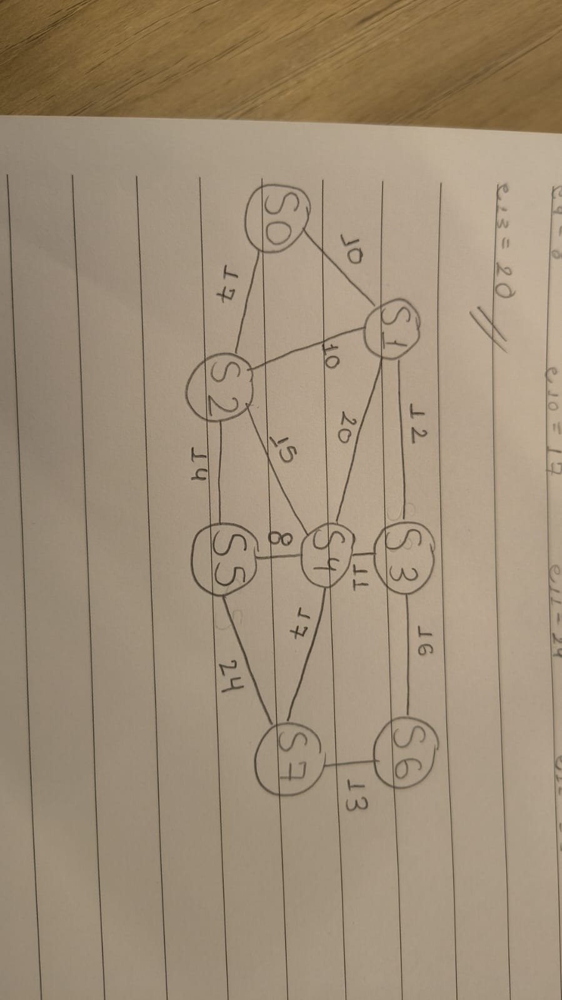

# Atividade-Ponderada-M8-Grafos
Atividade de Grafos
RA: 250290

# 1

1) Os números correspondentes de D0 a D6 são, respectivamente: 5, 1 , 0 , 2 , 9 , 0.
Como 0 é par, nosso destino é S6.
Os pesos, com base no RA, de e1 a e13, em Km, são, respectivamente: 10, 17, 10, 12, 15, 14, 11, 16, 8 ,17, 24 , 13 e 20.

2) 

3) 

4) 
 
