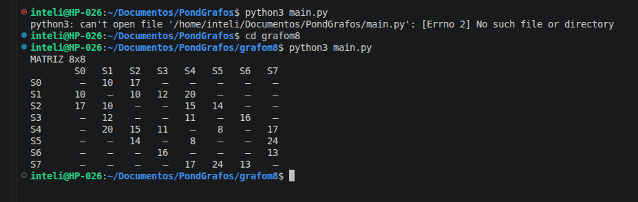

# Atividade-Ponderada-M8-Grafos
Atividade de Grafos
RA: 250290

### 1

1) Os números correspondentes de D0 a D6 são, respectivamente: 5, 1 , 0 , 2 , 9 , 0.
Como 0 é par, nosso destino é S6.
Os pesos, com base no RA, de e1 a e13, em Km, são, respectivamente: 10, 17, 10, 12, 15, 14, 11, 16, 8 ,17, 24 , 13 e 20.

2) 

3) Matriz de pesos 8×8

Dígitos do RA: D1 = 5, D2 = 1, D3 = 0, D4 = 2, D5 = 9, D6 = 0.

| | S0 | S1 | S2 | S3 | S4 | S5 | S6 | S7 |
|---|---|---|---|---|---|---|---|---|
| **S0** | — | 10 | 17 | — | — | — | — | — |
| **S1** | 10 | — | 10 | 12 | 20 | — | — | — |
| **S2** | 17 | 10 | — | — | 15 | 14 | — | — |
| **S3** | — | 12 | — | — | 11 | — | 16 | — |
| **S4** | — | 20 | 15 | 11 | — | 8 | — | 17 |
| **S5** | — | — | 14 | — | 8 | — | — | 24 |
| **S6** | — | — | — | 16 | — | — | — | 13 |
| **S7** | — | — | — | — | 17 | 24 | 13 | — |

4) Uma matriz é simétrica quando todo M[i][j] é igual a sua inversão, que seria M[j][i] com os mesmos valores correspondentes. Quando analisamos os valores da nossa matriz 8x8, podemos comprovar isso analisando a correspondência dos valores ( Por exemplo: M[1][3] é 17, e M[3][1] também é 17).

### 2 

1) Teste de mesa do Dijkstra

Os vértices entre colchetes são os fechados.

| Iter. | u | L[u] | S0 | S1 | S2 | S3 | S4 | S5 | S6 | S7 | Antecessores atualizados |
|---|---|---|---|---|---|---|---|---|---|---|---|---|
| Início | — | — | 0 | ∞ | ∞ | ∞ | ∞ | ∞ | ∞ | ∞ | Inicialização em S0 |
| 1 | S0 | 0 | [0] | 10 | 17 | ∞ | ∞ | ∞ | ∞ | ∞ | Ant[S1]=S0; Ant[S2]=S0 |
| 2 | S1 | 10 | [0] | [10] | 17 | 22 | 30 | ∞ | ∞ | ∞ | Ant[S3]=S1; Ant[S4]=S1 |
| 3 | S2 | 17 | [0] | [10] | [17] | 22 | 30 | 31 | ∞ | ∞ | Ant[S5]=S2 |
| 4 | S3 | 22 | [0] | [10] | [17] | [22] | 30 | 31 | 38 | ∞ | Ant[S6]=S3 |
| 5 | S4 | 30 | [0] | [10] | [17] | [22] | [30] | 31 | 38 | 47 | Ant[S7]=S4 |
| 6 | S5 | 31 | [0] | [10] | [17] | [22] | [30] | [31] | 38 | 47 | Nenhum |
| 7 | S6 | 38 | [0] | [10] | [17] | [22] | [30] | [31] | [38] | 47 | Nenhum |
| 8 | S7 | 47 | [0] | [10] | [17] | [22] | [30] | [31] | [38] | [47] | Nenhum |

**Ordem de fechamento:** S0 → S1 → S2 → S3 → S4 → S5 → S6 → S7
**Rota ótima:** S0 → S1 → S4 → S7
**Custo:** 10 + 20 + 17 = 47 km

### 3 

No main.py foi implementado o grafo com matriz de adjacência, o Dijkstra e o Prim.

Execução: python main.py

Print da evidência de console: 

### 4 

#### Rota e custo ótimo

- **Rota:** S0 → S1 → S4 → S7.
- **Distância mínima:** 10 + 20 + 17 = **47 km**.
- **Ordem de fechamento:** S0 → S1 → S2 → S3 → S4 → S5 → S6 → S7.

#### Contingência no ramal

- **Aresta removida:** e5 = (S2, S4), 15 km.
- **Nova rota ótima:** S0 → S1 → S4 → S7.
- **Novo custo:** **47 km**.
- **Acréscimo:** 47 − 47 = **0 km**.
- **Acréscimo percentual:** (0 / 47) × 100 = **0%**.

A rota não muda porque e5 não pertence ao caminho mínimo original.

#### Prim × Dijkstra

| Aresta | Conexão | Peso |
|---|---|---|
| e1 | S0–S1 | 10 km |
| e3 | S1–S2 | 10 km |
| e4 | S1–S3 | 12 km |
| e7 | S3–S4 | 11 km |
| e9 | S4–S5 | 8 km |
| e8 | S3–S6 | 16 km |
| e12 | S6–S7 | 13 km |

- O custo total do Prim é 80 km, enquanto o Dijkstra é 195 km. O prim minimiza a soma dos pesos das arestas necessárias para conectar todas as subestações e o Dijkstra minimiza a distância da origem a cada destino. A soma das distâncias do Dijkstra pode contar trechos repetidos, por isso não é equivalente ao custo do Prim, e a união das rotas mínimas não precisa ser uma árvore geradora mínima.